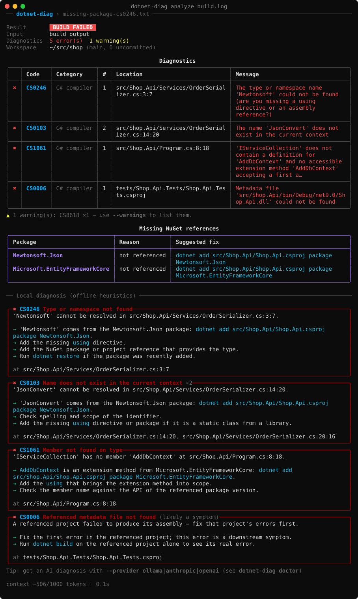
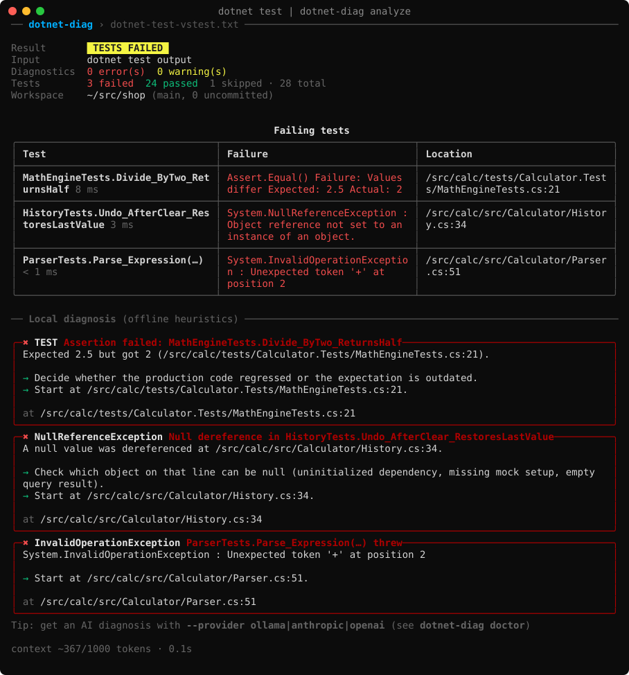
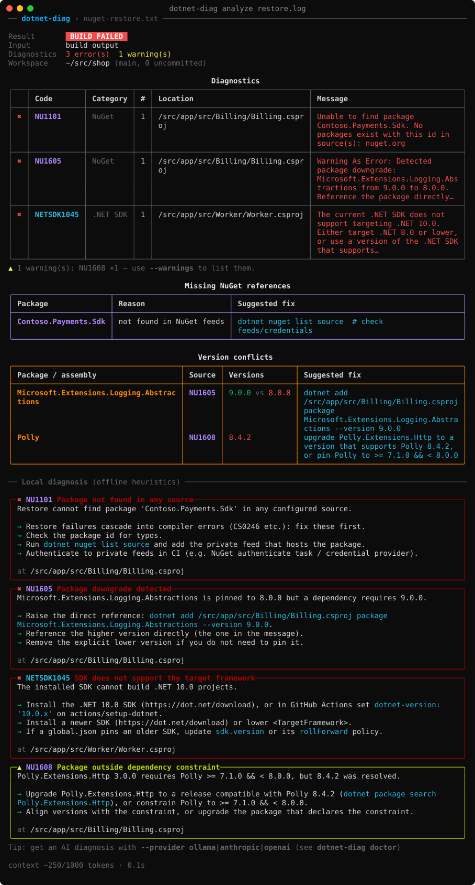
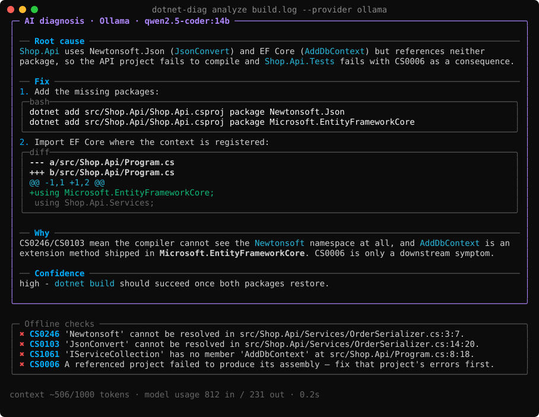

# dotnet-diag

**Diagnose failing .NET builds and tests from the command line.** `dotnet-diag` reads MSBuild binary logs, text build logs and `dotnet test` output, works out the root cause, and tells you what to change: missing NuGet references, version conflicts, SDK mismatches, or a concrete code patch.

It works offline with built-in heuristics for the most common MSBuild, compiler, NuGet and SDK errors. You can optionally add an AI diagnosis from a **local model through Ollama**, **Anthropic Claude**, or any **OpenAI-compatible endpoint**.

```bash
dotnet build -bl            # writes msbuild.binlog
dotnet-diag analyze msbuild.binlog

dotnet test 2>&1 | dotnet-diag analyze
```



---

## Contents

- [Features](#features)
- [Installation](#installation)
- [Usage](#usage)
- [AI providers](#ai-providers)
- [Using it in CI](#using-it-in-ci)
- [Sample output](#sample-output)
- [How it works](#how-it-works)
- [Building from source](#building-from-source)

## Features

- **Reads the logs you already have**
  - MSBuild binary logs (`-bl`). The format is detected by content, so the file extension doesn't matter.
  - Classic console output, terminal-logger output (`-tl`), and `-flp` file logs.
  - CI logs that contain timestamps, ANSI colors, or `##[error]` annotations.
  - `dotnet test` output in both formats: the VSTest console logger and Microsoft.Testing.Platform.
- **Finds the root cause, not just the first line.** Errors are de-duplicated (MSBuild prints every error twice) and grouped. They are ranked so restore and SDK failures come before the compiler errors they cause. Downstream symptoms such as `CS0006` are flagged as symptoms.
- **Detects missing NuGet references.** `dotnet-diag` maps unresolved types, namespaces and extension methods (`JsonConvert`, `AddDbContext`, `ILogger`, …) to the package that provides them. It reads your `.csproj` and `Directory.Packages.props` to tell "package missing" apart from "package present, `using` missing".
- **Detects version conflicts.** It pulls the package and the competing versions out of `NU1605`, `NU1107`, `NU1608`, `MSB3277`, `CS1705` and `Could not load file or assembly`, then proposes the exact `dotnet add package … --version` command.
- **Is git-aware.** Paths from CI machines (`/home/runner/work/app/app/src/...`, `D:\a\app\src\...`) are mapped onto your local working tree. Source lines around each error are included, and files with uncommitted changes are flagged.
- **Keeps the LLM context small.** The diagnostic bundle is limited to a token budget (default **1000 tokens**). Content is added in priority order, and anything that doesn't fit is counted as omitted rather than silently dropped.
- **Has rich terminal output.** Built on [Spectre.Console](https://spectreconsole.net/): progress spinners, color-coded error-code tables, and rendered Markdown with diff highlighting for AI answers.
- **Fits into CI.** It can write Markdown for `$GITHUB_STEP_SUMMARY`, write JSON for tooling, and gate a pipeline with `--exit-code`.

## Installation

Requires the [.NET 9 SDK](https://dot.net/download) or later.

```bash
dotnet tool install --global DotnetDiag.Tool
```

The package ID is `DotnetDiag.Tool` because `dotnet-diag` is already taken on nuget.org. The command it installs is `dotnet-diag`, which you can also run as `dotnet diag`.

To install from source (for example, before the package is published):

```bash
git clone https://github.com/siebe41/dotnet-diag.git
cd dotnet-diag
dotnet pack src/DotnetDiag.Cli -c Release
dotnet tool install --global DotnetDiag.Tool --add-source ./artifacts/nupkg
```

To update or remove the tool:

```bash
dotnet tool update --global DotnetDiag.Tool
dotnet tool uninstall --global DotnetDiag.Tool
```

## Usage

```text
dotnet-diag analyze [<input>] [options]   Analyze a binlog, a text log, or stdin
dotnet-diag explain <code> | --list       Explain a diagnostic code offline
dotnet-diag doctor                        Show the resolved AI provider configuration
```

### Examples

```bash
# Binary log: the richest input, with exact file, line and project for every diagnostic
dotnet build -bl
dotnet-diag analyze msbuild.binlog

# A folder: picks the newest *.binlog in it
dotnet-diag analyze ./artifacts/logs

# Pipe a failing test run (stderr included)
dotnet test 2>&1 | dotnet-diag analyze

# Try the committed sample failures (real logs from intentionally broken projects; see samples/README.md)
dotnet-diag analyze samples/missing-package.binlog --repo eval/scenarios/missing-package

# A log downloaded from CI, mapped onto your local checkout
dotnet-diag analyze ~/Downloads/build-log.txt --repo .

# Ask a local model through Ollama
dotnet-diag analyze msbuild.binlog --provider ollama --model qwen2.5-coder:14b

# Ask Claude
export ANTHROPIC_API_KEY=sk-ant-...
dotnet-diag analyze msbuild.binlog --provider anthropic

# See exactly what would be sent to the model (nothing is sent with --offline)
dotnet-diag analyze msbuild.binlog --offline --show-context

# Explain a code without any log
dotnet-diag explain NU1605
```

### `analyze` options

| Option | Description |
|---|---|
| `<input>` | A `.binlog`, a text log, a folder containing binlogs, or `-` for stdin. When omitted, input is read from stdin. |
| `-p, --provider` | `none`, `ollama`, `anthropic` or `openai` (any OpenAI-compatible server). |
| `-m, --model` | Model ID. Defaults: `claude-opus-5-5` (Anthropic) and `llama3.1` (Ollama). Required for `openai`. |
| `--endpoint` | Provider base URL, for example `http://gpu-box:11434` or `https://my-gateway/v1`. |
| `--api-key` | API key. Prefer the environment variables below so the key stays out of your shell history. |
| `--effort` | Anthropic effort level: `low`, `medium` (default), `high`, `xhigh` or `max`. |
| `--timeout` | Seconds to wait for the model (default 180). |
| `--offline` | Never call a model; print local hints only. |
| `--repo <dir>` | Source tree the log refers to (default: the git repository that contains the current directory). |
| `--max-context-tokens` | Token budget for the LLM bundle (default 1000). |
| `-f, --format` | `pretty` (default), `markdown` or `json`. |
| `--show-context` | Print the exact bundle that is, or would be, sent to the model. |
| `--warnings` | List warnings in the diagnostics table, not just a summary. |
| `--exit-code` | Exit with `1` when errors or failing tests are found. |

Exit codes: `0` means success, `1` means problems were found (only with `--exit-code`), and `2` means invalid input.

## AI providers

**An AI provider is only used when you select one explicitly.** You can select it with `--provider`, the `DOTNET_DIAG_PROVIDER` environment variable, or the config file. Having `ANTHROPIC_API_KEY` or `OPENAI_API_KEY` in your environment does not, on its own, send anything anywhere. When no provider is configured, or the provider fails, you get the structured local diagnosis.

| Provider | What it talks to | Required configuration |
|---|---|---|
| `ollama` | `POST /api/chat` on the local Ollama daemon. Nothing leaves your machine. | `ollama serve`, then `ollama pull <model>`. Endpoint comes from `OLLAMA_HOST` or defaults to `http://localhost:11434`. |
| `anthropic` | Claude Messages API (`POST /v1/messages`). | `ANTHROPIC_API_KEY`. Default model: `claude-opus-5-5`. On the first-party API, refusals automatically fall back to Anthropic's recommended model. |
| `openai` | `POST {endpoint}/chat/completions`: OpenAI, Azure OpenAI v1, vLLM, LM Studio, llama.cpp, LiteLLM, OpenRouter, and others. | `--model`. `OPENAI_API_KEY` is required for api.openai.com and optional for self-hosted servers. |

### Configuration precedence

Settings are resolved in this order: **command-line flags**, then **environment variables**, then the **config file**, then defaults. `dotnet-diag doctor` shows the resolved value of each setting and where it came from.

| Environment variable | Purpose |
|---|---|
| `DOTNET_DIAG_PROVIDER` | `ollama`, `anthropic`, `openai` or `none` |
| `DOTNET_DIAG_MODEL` | Model ID |
| `DOTNET_DIAG_ENDPOINT` | Base URL (overrides `OLLAMA_HOST`, `ANTHROPIC_BASE_URL` and `OPENAI_BASE_URL`) |
| `DOTNET_DIAG_API_KEY` | API key for any provider (falls back to `ANTHROPIC_API_KEY` or `OPENAI_API_KEY`) |
| `DOTNET_DIAG_EFFORT`, `DOTNET_DIAG_TIMEOUT` | Anthropic effort level, and request timeout in seconds |
| `DOTNET_DIAG_CONFIG` | Path to a config file other than the default |

The config file lives at `~/.config/dotnet-diag/config.json` on Linux and macOS, and at `%APPDATA%\dotnet-diag\config.json` on Windows:

```jsonc
{
  "provider": "ollama",
  "model": "qwen2.5-coder:14b",
  "endpoint": "http://localhost:11434",
  "timeoutSeconds": 120
}
```

### What is sent to the model

Only the budgeted diagnostic bundle is sent: a summary line, de-duplicated errors, failing tests with their user-code stack frames, a few source lines around the top locations, the affected projects' package references, and warning counts. Run `--show-context` to inspect it before you enable a cloud provider.

## Using it in CI

### GitHub Actions

```yaml
- name: Build
  run: dotnet build -bl:artifacts/build.binlog

- name: Diagnose build failure
  if: failure()
  run: |
    dotnet tool install --global DotnetDiag.Tool
    dotnet-diag analyze artifacts/build.binlog --format markdown >> "$GITHUB_STEP_SUMMARY"
    dotnet-diag analyze artifacts/build.binlog          # rich output in the job log
  env:
    DOTNET_DIAG_PROVIDER: anthropic                       # optional
    ANTHROPIC_API_KEY: ${{ secrets.ANTHROPIC_API_KEY }}
```

### Azure Pipelines

```yaml
- script: dotnet test 2>&1 | tee test-output.txt
- script: |
    dotnet tool install --global DotnetDiag.Tool
    dotnet-diag analyze test-output.txt
  condition: failed()
```

When stdout is not a terminal, `dotnet-diag` renders at 120 columns, or at the width in `COLUMNS` when that variable is set. Use `--format json` for machine-readable output.

## Sample output

These are real renderings of the test fixtures in [`tests/DotnetDiag.Tests/Fixtures`](tests/DotnetDiag.Tests/Fixtures).

### Failing tests piped from `dotnet test`



### Restore failures and version conflicts



### With an AI provider

For this screenshot the model response comes from a local stub server, so it shows the layout, not any particular model's quality.



<details>
<summary>Plain-text rendering (as it appears in CI logs)</summary>

```text
── dotnet-diag › missing-package-cs0246.txt ────────────────────────────────────────────────────

Result        BUILD FAILED
Input        build output
Diagnostics  5 error(s)  1 warning(s)
Workspace    ~/src/shop (main, 0 uncommitted)

                                          Diagnostics
╭───┬────────┬─────────────┬───┬───────────────────────────────┬───────────────────────────────╮
│   │ Code   │ Category    │ # │ Location                      │ Message                       │
├───┼────────┼─────────────┼───┼───────────────────────────────┼───────────────────────────────┤
│ ✖ │ CS0246 │ C# compiler │ 1 │ src/Shop.Api/Services/OrderSe │ The type or namespace name    │
│   │        │             │   │ rializer.cs:3:7               │ 'Newtonsoft' could not be     │
│   │        │             │   │                               │ found (are you missing a      │
│   │        │             │   │                               │ using directive or an         │
│   │        │             │   │                               │ assembly reference?)          │
├───┼────────┼─────────────┼───┼───────────────────────────────┼───────────────────────────────┤
│ ✖ │ CS0103 │ C# compiler │ 2 │ src/Shop.Api/Services/OrderSe │ The name 'JsonConvert' does   │
│   │        │             │   │ rializer.cs:14:20             │ not exist in the current      │
│   │        │             │   │                               │ context                       │
├───┼────────┼─────────────┼───┼───────────────────────────────┼───────────────────────────────┤
│ ✖ │ CS1061 │ C# compiler │ 1 │ src/Shop.Api/Program.cs:8:18  │ 'IServiceCollection' does not │
│   │        │             │   │                               │ contain a definition for      │
│   │        │             │   │                               │ 'AddDbContext' and no         │
│   │        │             │   │                               │ accessible extension method   │
│   │        │             │   │                               │ 'AddDbContext' accepting a    │
│   │        │             │   │                               │ first a…                      │
├───┼────────┼─────────────┼───┼───────────────────────────────┼───────────────────────────────┤
│ ✖ │ CS0006 │ C# compiler │ 1 │ tests/Shop.Api.Tests/Shop.Api │ Metadata file                 │
│   │        │             │   │ .Tests.csproj                 │ 'src/Shop.Api/bin/Debug/net9. │
│   │        │             │   │                               │ 0/Shop.Api.dll' could not be  │
│   │        │             │   │                               │ found                         │
╰───┴────────┴─────────────┴───┴───────────────────────────────┴───────────────────────────────╯
▲ 1 warning(s): CS8618 ×1 — use --warnings to list them.

                                    Missing NuGet references
╭───────────────────────────────┬────────────────┬─────────────────────────────────────────────╮
│ Package                       │ Reason         │ Suggested fix                               │
├───────────────────────────────┼────────────────┼─────────────────────────────────────────────┤
│ Newtonsoft.Json               │ not referenced │ dotnet add src/Shop.Api/Shop.Api.csproj     │
│                               │                │ package Newtonsoft.Json                     │
│ Microsoft.EntityFrameworkCore │ not referenced │ dotnet add src/Shop.Api/Shop.Api.csproj     │
│                               │                │ package Microsoft.EntityFrameworkCore       │
╰───────────────────────────────┴────────────────┴─────────────────────────────────────────────╯

── Local diagnosis (offline heuristics) ────────────────────────────────────────────────────────

╭─✖ CS0246 Type or namespace not found─────────────────────────────────────────────────────────╮
│ 'Newtonsoft' cannot be resolved in src/Shop.Api/Services/OrderSerializer.cs:3:7.             │
│                                                                                              │
│ → 'Newtonsoft' comes from the Newtonsoft.Json package: dotnet add                            │
│ src/Shop.Api/Shop.Api.csproj package Newtonsoft.Json.                                        │
│ → Add the missing using directive.                                                           │
│ → Add the NuGet package or project reference that provides the type.                         │
│ → Run dotnet restore if the package was recently added.                                      │
│                                                                                              │
│ at src/Shop.Api/Services/OrderSerializer.cs:3:7                                              │
╰──────────────────────────────────────────────────────────────────────────────────────────────╯
╭─✖ CS0103 Name does not exist in the current context ×2───────────────────────────────────────╮
│ 'JsonConvert' cannot be resolved in src/Shop.Api/Services/OrderSerializer.cs:14:20.          │
│                                                                                              │
│ → 'JsonConvert' comes from the Newtonsoft.Json package: dotnet add                           │
│ src/Shop.Api/Shop.Api.csproj package Newtonsoft.Json.                                        │
│ → Check spelling and scope of the identifier.                                                │
│ → Add the missing using directive or package if it is a static class from a library.         │
│                                                                                              │
│ at src/Shop.Api/Services/OrderSerializer.cs:14:20,                                           │
│ src/Shop.Api/Services/OrderSerializer.cs:20:16                                               │
╰──────────────────────────────────────────────────────────────────────────────────────────────╯
╭─✖ CS1061 Member not found on type────────────────────────────────────────────────────────────╮
│ 'IServiceCollection' has no member 'AddDbContext' at src/Shop.Api/Program.cs:8:18.           │
│                                                                                              │
│ → AddDbContext is an extension method from Microsoft.EntityFrameworkCore: dotnet add         │
│ src/Shop.Api/Shop.Api.csproj package Microsoft.EntityFrameworkCore.                          │
│ → Add the using that brings the extension method into scope.                                 │
│ → Check the member name against the API of the referenced package version.                   │
│                                                                                              │
│ at src/Shop.Api/Program.cs:8:18                                                              │
╰──────────────────────────────────────────────────────────────────────────────────────────────╯
╭─✖ CS0006 Referenced metadata file not found (likely a symptom)───────────────────────────────╮
│ A referenced project failed to produce its assembly — fix that project's errors first.       │
│                                                                                              │
│ → Fix the first error in the referenced project; this error is a downstream symptom.         │
│ → Run dotnet build on the referenced project alone to see its real error.                    │
│                                                                                              │
│ at tests/Shop.Api.Tests/Shop.Api.Tests.csproj                                                │
╰──────────────────────────────────────────────────────────────────────────────────────────────╯
Tip: get an AI diagnosis with --provider ollama|anthropic|openai (see dotnet-diag doctor)

context ~506/1000 tokens · 0.2s
```

</details>

<details>
<summary>The context sent to the model (<code>--show-context</code>), well under the 1000-token budget</summary>

````text
Diagnose this .NET failure.

## Summary
input: MSBuild binary log (msbuild.binlog) | result: FAILED | errors: 1 | warnings: 0
repo: branch feature/orders, 0 file(s) with uncommitted changes

## Errors (1 unique)
- CS0246 src/Broken/Program.cs:1:7: The type or namespace name 'Newtonsoft' could not be found (are you missing a using directive or an assembly reference?)

## Source
src/Broken/Program.cs:1
```csharp
>1 | using Newtonsoft.Json;
 2 |
 3 | var items = new List<int> { 1, 2, 3 };
 4 | Console.WriteLine(JsonConvert.SerializeObject(items));
```

## Package references
- src/Broken/Broken.csproj: (none)

## Offline heuristics (may be incomplete)
- CS0246: 'Newtonsoft' cannot be resolved in src/Broken/Program.cs:1:7.
````

</details>

## How it works

```text
 input ──► LogParser ──► ParsedLog ──► LocalDiagnosticEngine ──► hints, missing packages, version conflicts
            │  binlog (MSBuild.StructuredLogger)                       │
            │  MSBuild text / terminal logger                          ▼
            │  dotnet test (VSTest / MTP)          GitWorkspace ──► ContextBuilder ──► ≤1000-token bundle
            │                                      (path mapping,       │
            ▼                                       source, csproj)     ▼
     Spectre.Console renderer  ◄──────────────────────────────── PromptBuilder ──► ILlmProvider (optional)
                                                                                    Ollama │ Anthropic │ OpenAI-compatible
```

| Project | Responsibility |
|---|---|
| `src/DotnetDiag.Core` | Parsers (`Parsing/`), git working-tree access (`Workspace/`), the offline knowledge base and hint engine (`Hints/`), the token-budgeted context and prompt builders (`Context/`), HTTP providers (`Providers/`), and the Markdown/JSON reports (`Reporting/`). It has no UI dependencies. |
| `src/DotnetDiag.Cli` | The `System.CommandLine` command tree (`analyze`, `explain`, `doctor`), Spectre.Console rendering, and global-tool packaging. |
| `tests/DotnetDiag.Tests` | xUnit tests against realistic fixture logs: parser accuracy, hints, the context budget, prompt construction, provider HTTP contracts (with a fake handler), CLI end-to-end, and Windows/macOS/Linux platform behavior. |
| `eval/` | Usefulness evaluation: intentionally broken projects that are built for real, diagnosed, and fixed with the tool's own suggestions. Also includes a field-trial mode for grading real logs. See [docs/TESTING.md](docs/TESTING.md). |

### Known offline codes

`dotnet-diag explain --list` prints the full catalog. It covers the most common errors:

- **C# compiler:** `CS0006`, `CS0012`, `CS0029`, `CS0103`, `CS0246`, `CS0234`, `CS0535`, `CS1002`, `CS1061`, `CS1513`, `CS1705`, `CS5001`, `CS7036`, `CS8618`, …
- **MSBuild:** `MSB1009`, `MSB3021`, `MSB3027`, `MSB3073`, `MSB3245`, `MSB3277`, `MSB4018`, `MSB4019`, `MSB4062`, `MSB4236`, …
- **NuGet:** `NU1101`, `NU1102`, `NU1103`, `NU1107`, `NU1202`, `NU1301`, `NU1605`, `NU1608`, `NU1903`, …
- **.NET SDK:** `NETSDK1004`, `NETSDK1005`, `NETSDK1045`, `NETSDK1100`, `NETSDK1138`, …

## Building from source

```bash
dotnet build
dotnet test
dotnet run --project src/DotnetDiag.Cli -- analyze tests/DotnetDiag.Tests/Fixtures/nuget-restore.txt
dotnet pack src/DotnetDiag.Cli -c Release      # → artifacts/nupkg/DotnetDiag.Tool.<version>.nupkg
dotnet run --project eval/DotnetDiag.Eval      # usefulness eval: break real projects, diagnose, verify fixes
```

[docs/TESTING.md](docs/TESTING.md) describes the full verification plan: unit tests, platform tests, the usefulness eval with its scorecard and targets, and a field-trial protocol for real failures.

## License

[MIT](LICENSE)
